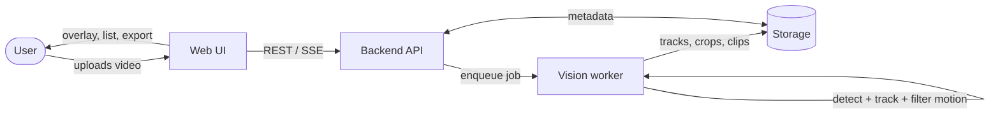

# MotionScope

**Development of an Application for Automatic Analysis and Extraction of Moving Objects in a Video Stream**

> Diploma project · Software Engineering · group SE-2416
> *MotionScope is a working title; rename freely before the final defense.*

| | |
|---|---|
| **Status** | Pre-defense 1: analysis, design, planning (no full application yet) |
| **Supervisor** | Shuryn Tutkyshbayeva |
| **Repository** | `https://github.com/aldiyarb123/movdet-video-analyzer` |
| **YouTrack** | `https://movdet-video-analyzer.youtrack.cloud/projects/DIP` (project key `DIP`) |
| **Latest tag** | `pre-defense-1` (to be created at submission, see [docs/pre-defense-1-submission.md](docs/pre-defense-1-submission.md)) |

---

## 1. What is this?

MotionScope is a web application that takes a video (an uploaded file first, a live stream later), finds the objects that **move**, follows each one over time, and lets the user **extract** the results: per-object tracks, cropped images, short clips and a machine-readable report.



## 2. Problem statement

Reviewing recorded or streamed video by eye to find "what moved, where and when" is slow and error-prone. Existing tools either require programming (libraries such as OpenCV, Ultralytics, Supervision), are cloud APIs billed per minute of video, or are built for a different job (camera recording systems such as Frigate). There is no lightweight, local, GUI-driven tool that turns a video file into a clean set of moving-object tracks and extracted clips. Details and sources: [docs/01-project-proposal.md](docs/01-project-proposal.md), [docs/04-existing-systems-comparison.md](docs/04-existing-systems-comparison.md).

## 3. Target users (hypotheses, to be validated by interviews)

- Small-site security operators reviewing recordings.
- Researchers and students who need object trajectories from video.
- Traffic / retail analysts counting and timing movement in a scene.

Evidence status: [docs/02-evidence-of-relevance.md](docs/02-evidence-of-relevance.md).

## 4. Expected outcomes

1. Web application: upload video, configure analysis, watch results with overlays, export.
2. Processing pipeline: detection, tracking, motion filtering, extraction of crops and clips.
3. Evaluation against a classical baseline (background subtraction) on public benchmarks and our own videos.
4. Complete engineering documentation and a reproducible test suite.

## 5. Team

| Member | Role | Main areas in this repository |
|---|---|---|
| Asylkhan Kozhanov | Frontend, UI, results visualization | `src/frontend/`, `prototype/`, `docs/08-ux-prototype.md` |
| Aldiyar Bazarbayev | Backend, video processing, API | `src/backend/`, `src/vision/`, `docs/07-architecture.md` |
| Alikhan Sekenov | Functional components, integration, testing, documentation | `tests/`, `docs/06-requirements.md`, `docs/09-verification-plan.md`, integration |

Supervisor: **Shuryn Tutkyshbayeva**.

## 6. Scope

**In scope (MVP):** video-file upload; detection and tracking of moving objects; motion filtering; results viewer with overlays; export (JSON/CSV report, crops, clips); job history; configuration of thresholds and classes; local deployment.

**Later / optional:** live RTSP stream input; zone and line-crossing counting; alert rules.

**Out of scope:** person identification / face recognition, multi-camera re-identification, cloud multi-tenant hosting, model training from scratch.

Full list and complexity justification: [docs/01-project-proposal.md](docs/01-project-proposal.md).

## 7. Selected technologies (proposed, see comparison)

| Layer | Choice | Alternatives considered |
|---|---|---|
| Detector | YOLO family (via Ultralytics) | MOG2 background subtraction, RF-DETR |
| Tracker | ByteTrack | BoT-SORT, DeepSORT |
| Backend | Python, FastAPI | Django REST, Flask |
| Jobs | Redis queue (RQ) + progress over SSE | FastAPI BackgroundTasks, gRPC |
| Storage | PostgreSQL + local file storage | SQLite, MongoDB |
| Frontend | React + TypeScript + Vite | Vue 3, Svelte |

Reasoning and scoring: [docs/05-technology-comparison.md](docs/05-technology-comparison.md). The team must confirm these choices.

## 8. Repository map

```
.
├── README.md
├── CONTRIBUTING.md             branching, commits, PR + YouTrack rules
├── docs/
│   ├── 01-project-proposal.md
│   ├── 02-evidence-of-relevance.md
│   ├── 03-literature-review.md
│   ├── 04-existing-systems-comparison.md
│   ├── 05-technology-comparison.md
│   ├── 06-requirements.md
│   ├── 07-architecture.md
│   ├── 08-ux-prototype.md
│   ├── 09-verification-plan.md
│   ├── 10-project-management-and-risks.md
│   ├── 11-supervisor-feedback.md
│   ├── pre-defense-1-submission.md
│   ├── rubric-checklist.md     what the committee asks for vs. where it is here
│   ├── adr/                    architecture decision records
│   └── evidence/               interview notes, screenshots, data
├── diagrams/
│   ├── src/                    editable Graphviz (.dot) sources
│   └── export/                 SVG + PNG exports
├── prototype/index.html        clickable UI mockup (open in a browser)
├── src/
│   ├── vision/                 baseline_mog2.py (verification baseline)
│   ├── backend/                (planned)
│   └── frontend/               (planned)
├── tests/                      automated tests
├── config/                     configuration examples
├── requirements.txt
└── .env.example
```

## 9. Documentation index

| # | Document | Rubric component |
|---|---|---|
| 1 | [Project proposal](docs/01-project-proposal.md) | Project proposal |
| 2 | [Evidence of relevance](docs/02-evidence-of-relevance.md) | Evidence of the relevance |
| 3 | [Literature review](docs/03-literature-review.md) | Literature review |
| 4 | [Existing systems comparison](docs/04-existing-systems-comparison.md) | Existing system comparison |
| 5 | [Technology comparison](docs/05-technology-comparison.md) | Technology comparison |
| 6 | [Requirements](docs/06-requirements.md) | Requirements specification |
| 7 | [Architecture](docs/07-architecture.md) · [diagrams](diagrams/export/) | Architecture and diagrams |
| 8 | [UX prototype](docs/08-ux-prototype.md) · [mockup](prototype/index.html) | UX / prototype |
| 9 | [Verification plan](docs/09-verification-plan.md) | Verification and evaluation plan |
| 10 | [Management and risks](docs/10-project-management-and-risks.md) | Project management and risks |
| 11 | [Supervisor feedback](docs/11-supervisor-feedback.md) | Supervisor feedback |

## 10. Setup, run, test

A runnable baseline already exists (the classical comparison method used in the evaluation).

```bash
python -m venv .venv
source .venv/bin/activate            # Windows: .venv\Scripts\activate
pip install -r requirements.txt

# run the baseline on a video, write tracks as JSON
python src/vision/baseline_mog2.py path/to/video.mp4 --out out/tracks.json

# run the automated tests
pytest -q
```

### Whole application with Docker (DIP-23)

Needs only [Docker Desktop](https://www.docker.com/products/docker-desktop/) (Windows, macOS) or Docker Engine with the compose plugin (Linux).

```bash
git clone https://github.com/aldiyarb123/movdet-video-analyzer.git
cd movdet-video-analyzer
docker compose up --build        # first build downloads PyTorch and the model, ~5-10 min
```

Open http://localhost:8080 (web UI) or http://localhost:8000/docs (API). Stop with `Ctrl+C`; `docker compose down -v` also deletes stored jobs. `MOVDET_PROCESSOR=stub docker compose up` runs the API with the fake analysis.

### Backend and pipeline without Docker

```bash
pip install -r requirements.txt
pip install torch torchvision --index-url https://download.pytorch.org/whl/cpu   # optional, CPU-only PyTorch
pip install -r requirements-ml.txt                                               # YOLO + trackers
MOVDET_PROCESSOR=pipeline uvicorn src.backend.app:app --reload                   # API on :8000
cd frontend && npm install && npm run dev                                        # UI on :5173
```

Command-line tools: `python -m src.vision.pipeline video.mp4 --out out/job1` (full analysis), `python src/vision/detector_tracker.py video.mp4` (tracking only), `python src/vision/benchmark_baseline.py video.mp4` (baseline speed).

## 11. Workflow

Every change: YouTrack task `DIP-n` → branch `DIP-n-short-name` → commits `DIP-n: message` → Pull Request reviewed by another team member → merge to `main`. Details: [CONTRIBUTING.md](CONTRIBUTING.md).
